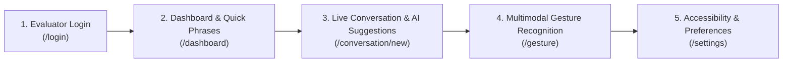

# VoiceExpression: Hackathon Evaluation & Live Demo Guide

**AI Manthan 2.0 — Problem Statement 16**  
**Role**: Multimodal Live Conversation Assistant for People with Speech Impairments  
**Demo Duration**: 5–7 Minutes  
**Evaluator Profile**: 1-Click Instant Login (Alex Mercer)

---

## 1. Demo Objectives & Key Talking Points

When presenting VoiceExpression to hackathon judges, emphasize these **four architectural pillars**:

1. **User Agency Preserved (No Auto-Speaking AI)**:
   - *Talking Point*: "Unlike systems that generate speech autonomously without patient oversight, VoiceExpression strictly treats AI as a drafting assistant. The patient remains in control: every candidate sentence requires explicit human confirmation (`Confirm`, `Edit`, or `Speak`) before audio is generated."

2. **Multimodal Accessibility**:
   - *Talking Point*: "Patients with ALS or cerebral palsy may tire quickly from typing. VoiceExpression fuses physical gestures (8 MediaPipe hand poses), telegraphic drafts ('I water'), and partner speech into clear, authentic first-person sentences."

3. **Ephemeral Privacy Safeguards**:
   - *Talking Point*: "We process camera frames and hand landmarks strictly in ephemeral memory. No video or audio is ever recorded to disk without active consent."

4. **Resilient Local Fallback**:
   - *Talking Point*: "If an internet outage occurs during a critical medical conversation, the app never crashes with a 500 error. It automatically switches to local memory persistence and browser speech synthesis."

---

## 2. Step-by-Step Hackathon Demonstration Script

---

### Step 1: Instant Evaluator Sign-In
1. Navigate to: `http://localhost:3000/login`
2. Point out the **"Evaluator Demo Account"** banner.
3. Click the purple button: **"Evaluator Demo Account"** (Alex Mercer).
4. *Expected Result*: Instant 1-click access with pre-configured accessibility settings; redirects to `/dashboard`.

---

### Step 2: Dashboard & 1-Tap Quick Phrases
1. On `/dashboard`, highlight the assistive layout:
   - Notice large touch targets (> 52px).
   - Show recent conversation summaries and statistics.
2. Under **"Quick Communication Phrases"**, click a category tab (e.g., **Needs** or **Emergency**).
3. Tap **"I want water."** or click its speaker icon.
4. *Expected Result*: Audio plays immediately using the configured speech engine, and an alert toast displays: *"Speaking: 'I want water.'"*

---

### Step 3: Live Conversation & AI Shorthand Clarification
1. Click **"New Conversation"** (or open an existing conversation).
2. Demonstrate how a patient with limited motor control inputs telegraphic shorthand:
   - In the composer, type: `I cold`
   - Notice the **AI Suggestions** panel below the message area.
3. Show the **Intent Badge** (`request_need`) and AI Rationale:
   - Suggestions appear:
     - *"Could you please give me a blanket? I am feeling cold."*
     - *"I feel quite cold in here."*
4. **Crucial Demonstration Point — User Agency Gate**:
   - Point out that **no audio is spoken automatically**.
   - Click **"Edit"** to adjust the phrasing, or click **"Confirm & Speak"**.
5. *Expected Result*: Message appears as confirmed in chat; speech audio is generated and played aloud.

---

### Step 4: Multimodal Gesture Recognition
1. In the sidebar, click **"Gesture Recognition"** (`/gesture`).
2. Show the **Privacy Notice**: *"Ephemeral Memory Processing: MediaPipe landmarks are computed entirely in volatile memory."*
3. Demonstrate without camera or with live camera:
   - **Option A (Interactive Vocabulary Tiles)**: Click on the **"Thumbs Up"** or **"Open Palm"** card in the vocabulary grid.
   - **Option B (Live Camera)**: Click **"Start Camera Preview"**, hold your hand up in a **Thumbs Up** or **Open Palm** pose, and click **"Capture Frame"**.
4. The **Gesture Result Card** appears with:
   - Detected Pose: `Thumbs Up` (Confidence: 94%)
   - Suggested Sentence: `"Yes, I agree."`
   - AI Expansion Alternatives: `["I agree with that plan.", "Yes, that sounds good."]`
5. **Strict Confirmation Gate**:
   - The user can click **"Confirm & Speak Aloud"** or **"Send to Chat"**.
   - Audio is generated ONLY after explicit button click.

---

### Step 5: WCAG AAA Accessibility & Voice Customization
1. Open the floating **Accessibility Toolbar** (top right) or navigate to `/settings`:
2. Toggle **High Contrast Mode**:
   - *Expected Result*: Interface transforms into WCAG AAA high contrast (pure black background, pure yellow `#FFFF00` borders and text with > 19:1 contrast ratio).
3. Click the **Text Scale** cycle button (`A` / `A+` / `A++`):
   - *Expected Result*: Root font scales dynamically from 100% to 115% to 130%.
4. Show the **Voice Cloning Consent Guard**:
   - Explain how patient biometric voice consent can be granted and revoked with 1 tap.

---

## 3. Sample Data vs. Live Interaction Notice

| Feature | Sample / Pre-loaded Data | Real-Time Live Interaction |
|---|---|---|
| **Demo User** | Alex Mercer (`alex@example.com`) | Any user registered via `/register` |
| **Quick Phrases** | 14 pre-categorized phrases (Basic, Needs, Emergency) | Fully customizable via `/settings` |
| **Gesture Dictionary** | 8 standard gestures (Open Palm, Fist, Thumbs Up/Down, Pointing, Peace, Stop, Wave) | Real-time MediaPipe 21-joint landmark detection |
| **Speech Audio** | High-fidelity local WAV chime buffer | Real ElevenLabs neural stream (when API key is present) |
| **Conversation Memory** | Pre-loaded medical demo check-in | Real-time MongoDB document persistence |

